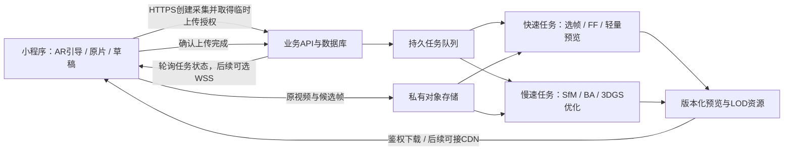

# 小芽扫描：AR 采集、快速预览与后台精建

2026-10-26。设计建议，未实现功能不得当成交付。当前工程已有原生相机、本机草稿、上传、服务器回执、农场互动、轻量 WebGL Gaussian 查看器；尚无 AR 跟踪、FF 自动推理、SfM 自动流水线或空间 LOD streaming。

## 产品闭环

选择一个静态物体或小角落 → 游戏用三个观察位置引导移动 → 保存干净原片 → 上传 → 快速生成可旋转的风景预览 → 玩家播种/浇水 → 后台精建完成后升级风景清晰度。基础成长在服务器确认真实采集后解锁，不等待慢任务，不在任务失败时扣掉已获得的成长。

物体可采用围绕目标的小弧线；靠墙物体、室内角落、街景采用侧移和斜角。不把完整 360° 作为所有场景的条件。引导点围绕同一目标，鼓励平移、重叠、清晰与前后层次；避免让用户追逐会离开目标的虚拟物。首次 Demo 只需一个物体/角落，不做整条街拼接。

采集后游戏可把真实局部场景装进一个“风景花盆”，植物/特效独立叠加。若要把物体从背景中完全抠出并自由摆放，另需分割、遮罩和物体提取，不能假设 FF 会自动生成干净单物体资产。

## 系统分工

小程序负责交互、相机、可用时的设备跟踪、低成本实时提示、本地保存、上传恢复和渲染；首版不在小程序内跑大型 FF/SfM。业务 API 管账号、归属、采集、游戏回执、任务与资源 manifest；不承担长 GPU 请求。原片、帧和模型进对象存储，数据库存索引和状态。GPU worker 通过私有授权拉取输入、回写产物。

初始部署建议：一台普通 CPU 云主机或容器承担 API/数据库/持久队列；私有 COS 存素材；单台按需 GPU worker 跑实验。4 vCPU/8 GB 控制服务、24 GB 显存级别 worker 只是小规模试验起点，需按模型、输入分辨率和帧数测量，不是容量保证。没有必要首轮上 Kubernetes。正式承诺快速预览延迟后，应给 FF 留独立容量，避免长时 SfM/3DGS 占满 GPU。

若已有实验室 GPU，可由它向公网 API 主动领任务并通过 HTTPS 访问 COS，不要求手机访问办公室内网。现有 Codespaces 可保留开发用途，不能承担稳定公开入口和 GPU SLA。所需资源为可用小程序 AppID/开发权限、云账号、稳定 HTTPS API 入口、对象存储、GPU 计算；正式环境按微信后台要求配置 request/upload/download 域名，WSS 仅使用时配置。具体域名与部署资质按供应商和微信后台当时要求办理。

## 手机与服务端如何通信

以下是新增协议建议，现有 `/v1/sessions` 不能被静默当成已实现这些字段。

1. 登录获得业务 token；正式账号可由服务端交换微信登录凭证。AppSecret 和云端永久密钥只在服务端。
2. 客户端生成固定 capture ID，创建或重试同一采集；服务端返回限路径、限操作、限时的上传授权。
3. 原片先在手机持久保存，再使用小程序适配的 COS SDK 上传；持久保存上传 ID、分片状态和本地路径。小程序退后台不能假定上传继续，重新进入后恢复。过期授权按原 object key 刷新。
4. 显式 complete 请求后，服务端核对对象归属、长度、内容 hash/解码和清单；仅客户端报告上传成功不足以发奖或排队。由 `(captureId, pipelineVersion, taskKind)` 去重，worker 失败可重试，完成结果幂等提交。
5. 前台每 2–3 秒轮询任务状态，离页停止，回来按 ID 查询。后续需要更密集进度再加 WSS；WSS 断连后仍靠状态查询恢复。不要让一个 HTTP 请求等完整重建。
6. 下载返回 manifest + 短期签名资源 URL。CDN 缓存不代表资源必须公开；原片始终私有。

任务状态应分别记录：upload（draft/uploading/verified）、preview（queued/running/ready/failed）、refine（queued/running/ready/failed）、dataReview（not_evaluated/accepted/rejected）、gameReceipt。快速预览失败不阻断后台精建，后台精建失败不撤销已有合法游戏回执；再次提交不重复发奖。

腾讯云有 [小程序临时授权直传实践](https://intl.cloud.tencent.com/zh/document/product/436/77182)。MVP 可以先维持现有 API 上传，再把大文件直传替换进去；重建任务始终异步。

## AR 采集的技术门槛

微信官方 [VisionKit v2 示例](https://github.com/wechat-miniprogram/miniprogram-demo/blob/master/miniprogram/packageAPI/pages/ar/visionkit-basic-v2/behavior.js) 展示 VKSession 与 WebGL 结合。可以从平面锚点和设备运动做“观察位置”引导，但平面 hit-test 不等于物体识别或高精度几何。

第一项技术验证必须是在目标 iPhone 上，确认同一条相机链路能获得：干净原始视频/帧、每帧时间、可用的相机内参与跟踪信息，同时显示 AR。不能假设现有 `<camera>` 录像和 VKSession 可以无冲突地同时占用相机，也不能把 AR 合成画面录入训练原片。需要检查图像方向、镜像、裁剪、内参对应分辨率、时钟和 tracking reset。

如同一链路暂不能兼顾原视频与 AR，则本轮保留原片质量优先的二维相机引导，并明确它不是空间 AR；对完整 AR+采集做独立技术验证。若它成为产品核心、而小程序能力无法满足，再迁到原生 iOS ARKit；后端协议可复用。不要为保留“小程序”标签牺牲双用途数据的连续原片。

能取得的 tracking 作为估计先验，记录来源、有效区间和重置事件；没有则显式 unknown。重建后的相机参数同样是估计值，不是实测真值。未来机器人使用还需尺度、几何、碰撞和任务验证。

## 两条重建任务

快任务：从同源原片选择清晰且有视差的候选帧，再按模型的实际输入契约选子集、估计所缺参数，运行 FF，输出移动端预览。不把所有 FF 模型都当成“随便传几帧即可”。[NoPoSplat](https://github.com/cvg/NoPoSplat) 支持无外参的稀疏多视角并生成 3DGS，但论文仍使用相机内参；[VGGT](https://vgg-t.github.io/) 输出几何与相机估计，并非直接替代一个 3DGS 预览流水线；[SHARP](https://github.com/apple-aiml-research/ml-sharp) 是单图附近视角合成，不能据此保证物体背面正确。最终模型需对自采室内外片段验证，并核对代码与权重许可。

慢任务：更多关键帧 → 特征/匹配 → SfM/束调整（BA） → 3DGS 优化 → 质量检测 → 移动端衍生资源。如果需要表面几何，再增加 MVS/mesh 等分支；SfM 本身不会产出完整精细 3DGS。[COLMAP 教程](https://colmap.github.io/tutorial.html) 明确区分稀疏 SfM 和稠密 MVS，并建议高重叠、不同机位而非仅原地转手机。

preview 与 refined 保存不同版本，不覆盖原片。每个产物携带 source capture/frame IDs、hash、模型/算法版本、坐标系、尺度来源和质量状态。跨版本使用真实对齐结果统一坐标；不能假设两个重建的朝向/尺度天然一致。游戏实例用独立锚点变换，资源就绪后在合适时机替换，避免瞬间跳动。

首屏等待 = 上传 + 排队/冷启动 + 推理 + 压缩 + 下载 + 首次渲染。模型论文的推理时间不是产品延迟。当前普通录像要等录完才取得临时文件；首个集成版先完整上传、服务器抽帧。后续只有在原始帧链路验证后才先传少量候选帧，并行上传完整视频，不能假装已经边拍边上传。未上传完/失败保留草稿，游戏不展示虚假百分比。

## 小程序中的 3DGS 渲染

现有原生 WebGL 查看器可复用首个 FF 预览：服务器默认裁到 60,000 点，硬上限 100,000，32 bytes/point 的预览格式，整文件下载后解析。60,000 点的文件约 1.92 MB；运行时还有解包、排序缓冲、GPU 副本，不能把下载大小当内存。当前排序在 JS，不能只把 MAX_POINTS 改大就叫大场景支持。

MVP：先用 30,000–60,000 点、基础颜色的局部预览，真实设备测首帧时间、拖动帧率、峰值内存、发热。观察到瓶颈后再做 worker 排序、减少缓冲复制、限制像素比例/透明过绘、按相机变化触发排序和上下文丢失恢复。能力探测后选择 WebGL 路径，不假定 iPhone 微信具备浏览器 WebGPU 能力。

建议验收目标（不是现有实测）：预览文件 1–5 MB；目标测试手机稳定约 30 FPS；预览资源下载后 2 秒内出现可交互画面；拍摄提交到真实首屏的 P50/P95 单独测量。低性能机使用更少点的同源衍生版。预渲染视频仅能标注为视频回放，不能冒充可交互 3D。

## 大场景 streaming

网络分片下载与空间 streaming 不同：下载大 PLY 的一段，并不代表这一段正好包含眼前需要的空间。

服务器先做空间分区/树、层级 LOD 和块压缩，生成 manifest（bounds、误差、层级、块路径、hash、大小与坐标系）。客户端先加载粗层全景，按视锥、投影误差和可见点预算加载细块；限制并发和 CPU/GPU 常驻内存，使用 LRU 淘汰，细块未到时保留粗层。处理迟到请求、鉴权续期、切场景取消和上下文恢复。父子 LOD 切换避免双重叠加；透明高斯跨块需要一致深度排序或专门的混合方案，不能每块随便独立排序。

[PlayCanvas Streamed SOG](https://developer.playcanvas.com/user-manual/gaussian-splatting/formats/streamed-sog/) 已定义空间树、多层 chunk 与索引，可参考其服务端产物和调度设计；[SuperSplat Viewer](https://github.com/playcanvas/supersplat-viewer) 是浏览器 Web 应用，不能直接当微信原生小程序组件使用。需要适配网络、文件、Worker、解码、WebGL 生命周期；SOG/WebP 与 GPU 纹理格式还要真机核对。首轮可在既有 `.splat` 格式上做少量独立空间块，不必一开始完整移植复杂浏览器引擎。

初始测试可设“粗层常驻 + 30k–100k 可见点预算 + 少量并发下载”，经真机测量再提高；不照搬浏览器百万点宣传值。多份扫描拼成街区还需要跨扫描配准/地图坐标，单靠 streaming 无法解决对齐。

## 递进验证

1. 先修复当前相机和原片保存，保留三次养成；用同一真实片段贯通云端 FF → 轻量原生查看器。先把实际可旋转预览给老板看。
2. 单独验证 AR 跟踪与干净原片同源采集；明确支持 iPhone/微信版本与失败退路。
3. 同一 capture ID 并行启动 SfM+3DGS 慢任务，保存各版资源；证明 preview 与 refined 来自同一次真实采集。
4. 选一个更大真实场景验证粗层首屏、分块加载和卸载；不把街区 streaming 作为首个物体 Demo 的上线门槛。

首轮必须测四个结果：真机采集/恢复成功率、真实预览端到端延迟、选帧注册与重建成功率、手机交互帧率和内存；游戏侧观察是否理解“扫描变成我的风景”、是否愿意第二次扫描。训练可用性单独评估。
